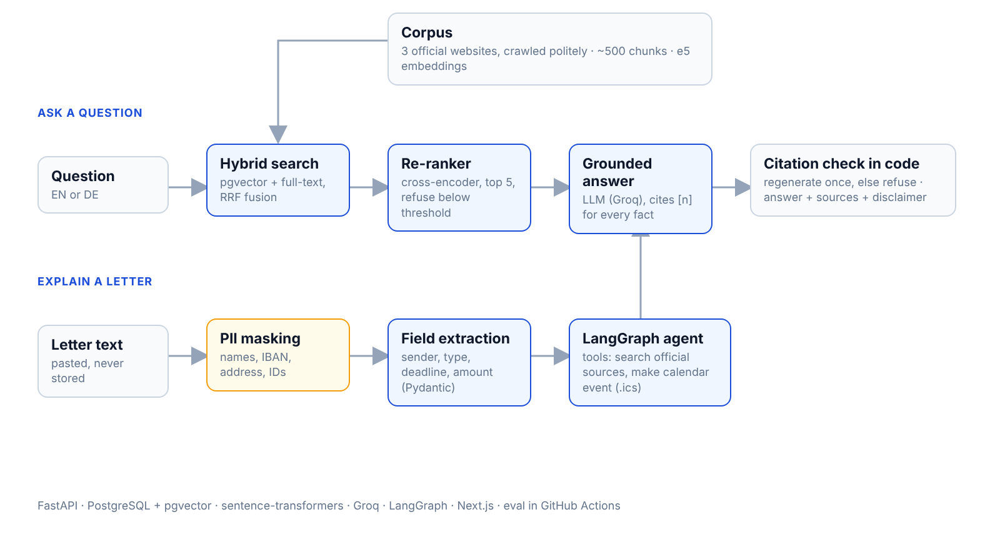

# BriefKlar

> Explains German official letters and bureaucracy rules to international students in simple
> English, with an official source for every answer.

**Live demo:** not hosted yet. It runs locally with Docker (see Quick start); a deployment guide is in [`DEPLOY.md`](DEPLOY.md).



Got a letter from the Beitragsservice or the Ausländerbehörde and don't understand it? Paste it
in. BriefKlar hides your personal data, pulls out the deadline, the amount and what you have to
do, explains the rules behind it from official websites, and gives you a calendar reminder.
It never answers from memory: if the official sources don't cover a question, it says so.

*General information from official sources, not legal advice.*

## Features (MVP)

- **Ask** questions in English or German about student jobs, visas, health insurance and the
  Rundfunkbeitrag. Answers in plain B1-level language with numbered citations and the date
  each source was checked.
- **Explain my letter:** regex masking of names, addresses, IBANs, IDs etc. *before* any LLM
  call → structured fields (deadline, amount, actions) validated with Pydantic → explanation of
  the rules with citations → `.ics` file with reminders 7 days and 1 day before the deadline.
- **Hybrid RAG:** pgvector (multilingual e5) + PostgreSQL full-text search, merged with
  Reciprocal Rank Fusion, re-ranked by a multilingual cross-encoder.
- **Refuses instead of guessing:** a re-ranker score threshold plus a citation check in code.
- **LangGraph agent** with two tools (`search_official_sources`, `make_calendar_event`) and a
  deterministic fallback plan.
- **Evaluation** with real numbers, a CI quality gate and an honest failure log.

## Results

Eval set: 30 answerable questions (15 EN, 15 DE, every expected answer checked against the
source by hand), 10 unanswerable questions, 5 synthetic letters with fake personal data.

| Retrieval | hit@5 | MRR | Answer correctness | Refusal accuracy |
|---|---|---|---|---|
| vector only | 0.83 | 0.73 | – | 0.00 |
| hybrid (vector + full-text, RRF) | 0.77 | 0.64 | – | 0.00 |
| hybrid + cross-encoder re-rank | **0.97** | **0.84** | **0.93** | **1.00** |

| Letter path | Field accuracy | PII leaks into prompts | Calendar reminder | Explanation answered | p95 latency |
|---|---|---|---|---|---|
| 5 synthetic letters | **1.00** (20/20) | **0** | 5/5 | 3/5 ¹ | 26.8 s |

¹ The two refused letters come from the Ausländerbehörde and a Krankenkasse, which are not in
the three crawled sources yet. Refusing there is the intended behaviour, not a crash.

From [`eval/results/summary.md`](eval/results/summary.md) (answers: 23.11.2026, LLM judge v2;
a stricter first judge gave 0.70). What I learned, the two remaining failures (one refusal
where the answer exists, one conflict between official sources) and why the judge rubric
changed: [`eval/NOTES.md`](eval/NOTES.md).

## How it works

```
question ─┬─ vector search (pgvector, HNSW) ──┐
          └─ full-text search (tsvector) ─────┴─ RRF ─ cross-encoder ─ score ≥ threshold?
                                                                         │ no → refuse + official link
                                                                         └ yes → LLM answer from the
                                                                           top 5 chunks only → citation
                                                                           check in code → response
letter ─ mask PII ─ extract + validate fields ─ agent: search → calendar → answer → citation check
```

Sources (72 pages, 500 chunks): study-in-germany.com (DAAD), arbeitsagentur.de,
rundfunkbeitrag.de. Crawled politely (robots.txt, 1 request/second), re-crawls skip unchanged
pages via a content hash.

## Tech stack

| Layer | Choice |
|---|---|
| Backend | Python 3.12, FastAPI, Pydantic v2, SQLAlchemy 2, psycopg 3 |
| Retrieval | PostgreSQL 16 + pgvector, `intfloat/multilingual-e5-small`, `cross-encoder/mmarco-mMiniLMv2-L12-H384-v1` |
| LLM | Groq: `openai/gpt-oss-120b` (answers), `openai/gpt-oss-20b` (fallback, planner, eval judge) |
| Agent | LangGraph |
| Frontend | Next.js, TypeScript, Tailwind CSS |
| Ops | Docker Compose, Caddy (HTTPS), GitHub Actions (lint, tests, frontend build, eval gate), Vercel |

## Run locally (Windows PowerShell)

```powershell
Copy-Item .env.example .env      # set POSTGRES_PASSWORD (+ same in DATABASE_URL) and GROQ_API_KEY
docker compose --env-file .env -f infra/docker-compose.yml up -d db

cd backend
py -3.12 -m venv .venv ; .\.venv\Scripts\Activate.ps1
pip install torch --index-url https://download.pytorch.org/whl/cpu
pip install -e ".[dev,ml]"
python -m app.db                 # create tables
python -m app.ingest.crawl       # crawl, chunk, embed, store (safe to re-run)
uvicorn app.main:app --reload    # http://localhost:8000/docs

cd ..\frontend
Copy-Item .env.example .env.local
npm install ; npm run dev        # http://localhost:3000
```

Tests: `cd backend ; ruff check . ; pytest --cov=app` (no real API calls, the LLM is mocked).

## Evaluation

```powershell
cd backend
python ..\eval\run_eval.py --mode vector                     # retrieval only, free
python ..\eval\run_eval.py --mode hybrid+rerank --tune       # + refusal threshold suggestion
python ..\eval\run_eval.py --mode hybrid+rerank --answers    # + answers and LLM judge
python ..\eval\run_eval.py --letters                         # field accuracy + PII leak check
```

## Privacy and legal

- Personal data in letters is masked before any LLM call; the eval checks that the fake names
  never reach a prompt. Raw letter text is never logged or stored. No accounts, no cookies.
- Text from letters and web pages is treated as data, never as instructions (stated in every
  system prompt).
- BriefKlar explains what official pages say. It does not decide individual cases and never
  writes appeals (Widerspruch).

## Limitations

- Regex masking can miss unusual formats (Presidio is planned for v2).
- Three sources only; pages can change after the "checked on" date.
- Free Groq tier: roughly 2–3 answers per minute in total.
- Thresholds and the judge rubric were tuned on the same small eval set (see `eval/NOTES.md`).

## Roadmap (v2)

Photo/PDF upload with OCR, Presidio masking, weekly re-crawl with change alerts, more sources
(BAMF, Krankenkassen), a held-out eval set, feedback buttons.

Deployment guide: [`DEPLOY.md`](DEPLOY.md) · Code walkthrough: [`LEARNING.md`](LEARNING.md)
